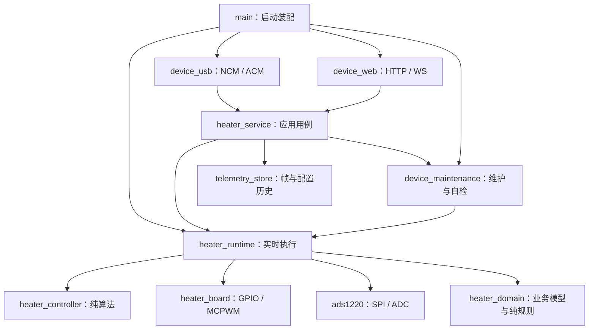

# 架构与状态归属

## 组件依赖

运行内核不依赖网页、USB 或记录器。main 将 `telemetry_store_set_run` 注入内核，回调只更新内部 RAM 接收门。记录器不反向查询内核；输出由内核及板级组件操作。

## 文件与任务

| 文件 | 职责 | 执行上下文 |
|---|---|---|
| `phase_engine.c` | 固定绝对阶段、互锁与 PWM 锁存 | Core 1 GPTimer ISR |
| `acquisition.c` | DRDY 锁存、ADC 启动/读取、换算及截止检查 | Core 1 ISR / 周期任务 |
| `runtime.c` | 初始化、周期任务、帧发布、独立观察快照 | Core 1，20，6144 字节 |
| `run_state.c` | 运行、模式、租约、配置身份、暂停恢复及结果接收 | 短锁公共接口 / Core 1 |
| `output_guard.c` | 快速停止、PWM 故障锁存 | 实时任务 / ISR / 外部停止入口 |
| `controller_worker.c` | 配置准备、算法执行与反馈 | Core 0，7，6144 字节 |
| `telemetry_store.c` | 接收门、历史、配置引用、停止屏障 | Core 0，6，4096 字节 |
| `device_maintenance.c` | 应用门闩与 Flash 事务所有权 | 请求任务 / OTA 任务 |
| `boot_verify.c` | 后台样本自检与版本确认 | Core 0，5，4096 字节 |
| `usb_network.c` / `rescue_console.c` | USB 网络收发与日志、STOP/PING | Core 0，TinyUSB 5；网络/救援 4 |
| `device_web.c` | HTTP、WS 与资源适配 | Core 0，4，14336 字节 |

组件不等于任务；应用服务同步编排用例，不额外创建协调任务。HTTP 推送为 Core 0 优先级 3、4096 字节；OTA 写入为 Core 0 优先级 5、6144 字节。

## 状态与通信

设备生命周期、运行状态、模式和配置准备分别使用枚举。运行真值、运行 ID、取消代次及生效输出属于内核；算法配置和算法状态属于工作任务；历史和元数据属于记录器；口令及版本确认属于维护服务。

ISR 共享状态位于 `private/runtime_internal.h`。完整算法参数、配置历史、HTTP 状态和安全观察帧不进入 ISR 共享对象。算法只包含 `private/controller_worker.h`，该契约不暴露硬件头文件或内核状态。

算法有独立配置队列和测量覆盖队列：配置请求可靠提交，队列满返回错误；测量只保留最新帧。四个结果槽携带 `run_id/config_id/generation/apply_sequence`，在周期边界核验。通知只表示有工作，共享状态与序号决定工作是否仍有效。

应用用例开始时捕获取消代次。STOP 绕过门闩并递增代次；先前被抢占的 START 随后恢复也会被拒绝。算法故障只提交通知，Core 1 匹配身份后关断。记录帧也携带代次，STOP 后旧消息不会混入新运行。

## 元数据与锁

配置表固定 64 份，每份保存模式、参数、版本、手动设定与校准快照。历史覆盖时解除旧配置引用。当前配置固定保留；无引用旧配置还保留至少 64 帧，覆盖长度 32 的队列及发布中的帧。无可用槽时拒绝新实验。

内核短锁不等待网络、历史锁或 Flash。记录器依次取得 ring mutex 与接收门短锁，不回调内核。配置提交只在内核锁内进行非阻塞队列发送；算法工作任务释放自身锁后才回报内核。Flash mutex 跨完整操作持有；应用门闩可从 HTTP 转交 OTA worker，禁止使用可跨任务释放的 mutex。
