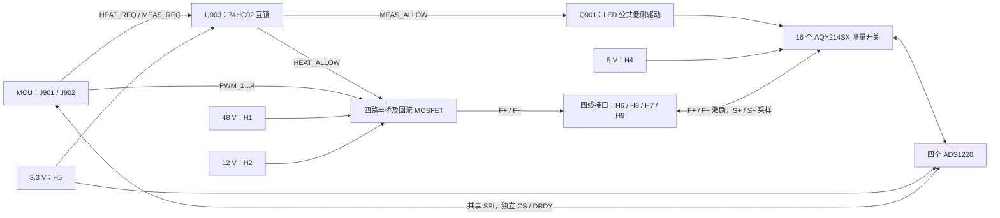

# 硬件连接与器件参考

- [原理图 newcontrol_project_2026-11-13.pdf](newcontrol_project_2026-11-13.pdf)：单页，图名 `Schematic1`，板名 `Board1`，版本 `V1.0`；图框创建日期为 2026-10-24、更新日期为 2026-11-04，与文件名日期不同。
- [网表 newcontrol_2026-11-13.tel](newcontrol_2026-11-13.tel)：包含器件封装、阻容标称值及网络端点；许多有源器件的 Value 为 `{Value}`，不能单靠网表确定型号。
- [GPIO 与排针映射 gpio.md](gpio.md)：J901、J902 各 22 针的 MCU 侧功能。

文中的“推导”表示由电路连接得到的工作原理，不代表已验证的固件行为或实板测量结果。器件手册补充信息在相应位置注明来源。

## 1. 总体结构

底板具有四路结构基本相同的加热与电阻测量通道。每路包含一个 48 V 半桥、一个独立的回流 MOSFET、四个 PhotoMOS 测量开关及一个 ADS1220 ADC。四路共用 SPI 总线、加热许可和测量许可；PWM、ADC 片选、ADC 数据就绪信号分别独立。

所有供电和信号电路使用同一个 `GND`。PhotoMOS 隔离了自身 LED 与输出触点，但整块板的 MCU、ADC、功率电路并非彼此电气隔离。

## 2. 电源与外部接口

### 2.1 电源排针

| 位号 | 原理图型号 / 网表封装 | 奇数脚 1、3、5、7 | 偶数脚 2、4、6、8 | 用途 |
| --- | --- | --- | --- | --- |
| H1 | PZ254V-12-8P / 2×4、2.54 mm 排针 | GND | 48V | 四路高侧功率 MOSFET 漏极 |
| H2 | 同上 | GND | 12V | 四路半桥驱动、自举电路和 U901/U902 回流驱动 |
| H4 | 同上 | GND | 5V | 测量开关 LED 阳极供电；同时连接 J901.21 |
| H5 | 同上 | GND | 3.3V | ADC 的 AVDD/DVDD 及互锁逻辑 U903 |

各接口同一电源侧的四个引脚并联；编号并不代表四路独立供电。没有 H3。资料未给出排针的额定电流，也未给出阻容的耐压和电源容量。

图中未绘出产生 12 V、5 V、3.3 V 的稳压电路，也未绘出主电源保险丝、主功率限流或电流采样电路；这些电源从接口引出/接入，其实际来源须结合外部供电确认。

### 2.2 四线探头 / 负载接口

原理图将这组接口标为“PT100接口”，型号为 `2.54-1*4P母`，网表封装为 1×4、2.54 mm 母排针。**通道 2 是 H8，通道 3 是 H7。**

| 通道 | 接口 | 1 脚 | 2 脚 | 3 脚 | 4 脚 |
| --- | --- | --- | --- | --- | --- |
| 1 | H6 | F1+ / H1_FP | S1+ / H1_SP | S1− / H1_SN | F1− / H1_FN |
| 2 | H8 | F2+ / H2_FP | S2+ / H2_SP | S2− / H2_SN | F2− / H2_FN |
| 3 | H7 | F3+ / H3_FP | S3+ / H3_SP | S3− / H3_SN | F3− / H3_FN |
| 4 | H9 | F4+ / H4_FP | S4+ / H4_SP | S4− / H4_SN | F4− / H4_FN |

`F` 为电流端，兼作加热电流端和测量激励端；`S` 为电压取样端。推导的外部四线连接是：F+、S+ 接被测电阻的一端，F−、S− 接另一端，电流线与取样线分别布线。底板内没有直接将 F+ 与 S+、F− 与 S− 短接；探头内部结构、实际负载型号及接线方向未在资料中给出。接口针号按原理图定义，不能据此确定插头从哪一侧观察。

### 2.3 MCU 排针与供电边界

J901、J902 的原理图型号均为 `ZX-PM2.54-1-22PY`，网表封装为 1×22、2.54 mm 母排针。图中“MCU”区域只画了这两组排针，没有 MCU 芯片、模组、USB 接口或开发板内部电路。

- J901.21 接板上 `5V`，J901.22 与 J902.1/.21/.22 接 `GND`。
- gpio.md 将 J901.1/.2 定义为 MCU 侧 `VDD33`，并注明两脚短接；但底板原理图在这两脚标了不连接，网表也没有端点。因此底板 `3.3V` **没有通过 J901.1/.2 与 MCU VDD33 相连**，其板上接口是 H5。
- gpio.md 所述 J901.21 的防反接二极管应属于 MCU 侧资料；本底板图中未画出该二极管，不能由此确认完整供电保护或 USB 与外部 5 V 的共存方式。
- 这三份资料不足以确定 MCU 模组的完整订货型号、Flash/PSRAM 容量或 USB 接线。GPIO 映射用于本项目 MCU 对接，不将开发环境配置视为原理图事实。

## 3. 主要有源器件

| 位号 | 数量 | 原理图标注型号 | 网表封装 | 电路作用 |
| --- | --- | --- | --- | --- |
| U101、U201、U301、U401 | 4 | ADS1220IPWR | TSSOP-16 | 每路独立 ADC，集成 PGA、参考源及可编程激励电流源 |
| U102～U105、U202～U205、U302～U305、U402～U405 | 16 | AQY214SX | SOP-4 | 常开 PhotoMOS，分别切换 F+、F−、S+、S− 的测量路径 |
| U106、U206、U306、U406 | 4 | IRS2104STR(UMW) | SOIC-8 | 高低侧互补半桥驱动，12 V 供电 |
| U902 | 1 | TC4427EOA | SOIC-8 | 双路同相 MOSFET 驱动，控制通道 3、4 回流开关 |
| U901 | 1 | **未注明** | SOIC-8 | 引脚名和连接与 U902 对应，控制通道 1、2 回流开关；同为 TC4427 是推测 |
| U903 | 1 | 74HC02D,653 | SOIC-14 | 四个二输入 NOR 门组成加热/测量互锁 |
| Q101、Q102、Q201、Q202、Q301、Q302、Q303、Q401、Q402、Q403 | 10 | IRFR120NTRPBF | TO-252 | N 沟道功率 MOSFET；8 个半桥器件和通道 3、4 回流开关 |
| Q103、Q203 | 2 | **未注明** | TO-252 | 通道 1、2 回流 N 沟道 MOSFET；与 Q303/Q403 同型号是推测 |
| Q901 | 1 | **未注明** | SOT-23-3 | N 沟道 MOSFET，吸收 16 个测量开关 LED 的公共阴极电流 |
| D101、D201、D301、D401 | 4 | ES1J | SMA | 半桥高侧自举二极管 |

按网表统计共有 171 个位号：27 个 U、13 个 Q、4 个 D、76 个 R、41 个 C、8 个 H、2 个 J。该数量包含未注明型号的器件。

IRFR120N 的器件手册给出漏源耐压 100 V、栅源极限 ±20 V；这些是单个器件参数，不能据此确定整板的工作电压或可持续输出电流。[Infineon IRFR120N 手册](https://www.infineon.com/assets/row/public/documents/24/49/infineon-irfr120n-datasheet-en.pdf)

## 4. 四路加热功率电路

### 4.1 通道器件对应

| 通道 | 半桥驱动 | 高侧 MOSFET | 半桥低侧 MOSFET | F− 回流 MOSFET | 回流驱动输出 |
| --- | --- | --- | --- | --- | --- |
| 1 | U106 | Q101 | Q102 | Q103 | U901.7 OUTA |
| 2 | U206 | Q201 | Q202 | Q203 | U901.5 OUTB |
| 3 | U306 | Q301 | Q302 | Q303 | U902.7 OUTA |
| 4 | U406 | Q401 | Q402 | Q403 | U902.5 OUTB |

下文以通道 1 为例，通道 2～4 的对应器件编号分别加 100、200、300。

### 4.2 半桥与自举连接

- Q101：1 脚为栅极、2 脚漏极接 48V、3 脚源极接 `F1+`。
- Q102：1 脚为栅极、2 脚漏极接 `F1+`、3 脚源极接 GND。
- U106：1 脚 VCC 接 12V，2 脚 IN 接 `PWM_1`，3 脚 `SD#` 接 `HEAT_ALLOW`，4 脚 VSS 接 GND，6 脚 VS 接 `F1+`。
- U106.7 HO 经 R110（22 Ω）接 Q101 栅极；R113（100 kΩ）接 Q101 栅源之间。
- U106.5 LO 经 R111（22 Ω）接 Q102 栅极；R114（100 kΩ）接 Q102 栅源之间。
- D101 的 2 脚接 12V、1 脚接 U106.8 VB；按图中二极管方向，12 V 经 D101 向 VB 自举节点充电。C106（1 µF）接 VB 与 VS/F1+ 之间，属于浮动自举电容。
- R116（100 kΩ）将 PWM_1 下拉，R117（100 kΩ）将 HEAT_ALLOW 下拉。
- C107（100 nF）与 C108（1 µF）跨接 12V/GND；C109（100 nF）与 C110（1 µF）跨接 48V/GND。

依据图中 `SD#` 符号及 IRS2104 系列时序，HEAT_ALLOW 为高时驱动放行，低时 HO/LO 都关闭；放行后 PWM 高对应高侧导通，PWM 低对应半桥低侧导通。该驱动有内部半桥死区和欠压锁定，高侧采用自举供电，不能将持续 100% 高电平视为高侧可无限保持导通的保证。[Infineon IRS2104 手册，第 4～5 页](https://www.infineon.com/assets/row/public/documents/24/49/infineon-irs2104-datasheet-en.pdf)

上述手册是 IRS2104 系列功能参考；图中明确标注 UMW 供应商，实际器件的时序极限仍应以对应供应商及实装器件为准。

### 4.3 回流开关与加热路径

- Q103：1 脚栅极经 R112（22 Ω）接 U901.7，2 脚漏极接 `F1−`，3 脚源极接 GND；R115（100 kΩ）接栅源之间。
- U901 的 INA（2 脚）、INB（4 脚）均接 HEAT_ALLOW，VDD（6 脚）接 12V，GND（3 脚）接 GND；1、8 脚为 NC。U902 的连接方式相同。
- U901 的 OUTA/OUTB 分别驱动 Q103/Q203；U902 的 OUTA/OUTB 分别驱动 Q303/Q403。四个 F− 回流开关共同受 HEAT_ALLOW 控制，没有逐路回流许可。
- R118、R218、R318、R418 均为 HEAT_ALLOW 到 GND 的 10 kΩ 下拉；通道 2 的 R218 引脚方向与其他三只相反，但电气功能相同。
- U901 的电源旁路为 C901（100 nF）与 C902（1 µF）；U902 为 C903（100 nF）与 C904（1 µF）。

U902 的 TC4427 是同相驱动，输入高时输出高，因此 HEAT_ALLOW 高会使通道 3、4 的 F− 接地；通道 1、2 按相同设计意图工作，但 U901 型号尚未确认。[Microchip TC4426/TC4427/TC4428 手册](https://ww1.microchip.com/downloads/en/DeviceDoc/20001422G.pdf)

推导的加热电流路径为：`48V → 高侧 MOSFET → F+ → 外部电阻负载 → F− → 回流 MOSFET → GND`。放行期间 PWM 低时，F+ 由半桥低侧拉向地，F− 仍由回流开关接地，负载两端电压接近零。

**PWM 为零与撤销 HEAT_ALLOW 不同**：前者在加热放行状态下仍让半桥低侧与回流 MOSFET 导通；后者关闭半桥驱动并撤销回流驱动。关闭 MOSFET 后仍有体二极管和寄生路径，不能将 F+/F− 当作理想的完全隔离端口。

## 5. 测量开关与 ADC

### 5.1 共用 PhotoMOS LED 驱动

全部 16 个 AQY214SX 的 LED 阳极（1 脚）分别经 680 Ω 电阻接 5V，LED 阴极（2 脚）共接 `MEAS_LED_K`。Q901 的 3 脚漏极接该公共阴极，2 脚源极接 GND，1 脚栅极经 R901（100 Ω）接 MEAS_ALLOW；R902（100 kΩ）为栅源下拉。

推导：MEAS_ALLOW 高时 Q901 导通，16 个测量开关同时闭合；低时释放。测量许可是全局信号，没有逐路 PhotoMOS 控制。按 LED 正向压降典型值 1.25 V 估算，标称 5 V 下每只 LED 约 `(5−1.25)/680 ≈ 5.5 mA`，总电流约 88 mA，尚未计入 Q901 压降及元件偏差。

AQY214SX 是常开型，手册/产品页给出导通电阻典型 25 Ω、最大 35 Ω，开通时间最大 0.5 ms、关断时间最大 0.2 ms，推荐 LED 电流至少 5 mA。这些时间有规定的测试条件，不包含本板 ADC 滤波、GPIO 切换或电源偏差。Q901 的型号未给出，需确认其在 3.3 V 栅极驱动下的电流能力和压降。[Panasonic AQY214SX 产品参数](https://industry.panasonic.com/global/en/products/control/relay/photomos/number/aqy214sx)

### 5.2 每路四个测量开关

| 功能 | 通道 1 | 通道 2 | 通道 3 | 通道 4 | 开关输出端 3 ↔ 4 |
| --- | --- | --- | --- | --- | --- |
| 正端激励 | U102 / R105 | U202 / R205 | U302 / R305 | U402 / R405 | Hn_IEXC ↔ Fn+（原理图 Hn_FP） |
| 负端回流 / 参考 | U103 / R106 | U203 / R206 | U303 / R306 | U403 / R406 | Hn_REF_RAW ↔ Fn−（原理图 Hn_FN） |
| 正端取样 | U104 / R107 | U204 / R207 | U304 / R307 | U404 / R407 | Hn_SP_SW ↔ Hn_SP |
| 负端取样 | U105 / R108 | U205 / R208 | U305 / R308 | U405 / R408 | Hn_SN_SW ↔ Hn_SN |

表中 n 为通道号；R105～R108 及其他通道对应电阻均为各开关 LED 的 680 Ω 串联电阻。

### 5.3 ADC 引脚连接

四个 ADS1220 的引脚拓扑相同，以下用 `Un01` 表示 U101/U201/U301/U401。

| ADC 引脚 | 引脚名 | 本板连接 |
| --- | --- | --- |
| 1 | SCLK | SPI_SCK，共享 |
| 2 | CS# | ADC_CS_n，各路独立，10 kΩ 上拉至 3.3V |
| 3 | CLK | GND；使用内部时钟的接法 |
| 4、5 | DGND、AVSS | GND |
| 6 | AIN3/REFN1 | GND |
| 7 | AIN2 | Hn_IEXC；可将内部 IDAC 路由到这里作为激励输出 |
| 8 | REFN0 | GND |
| 9 | REFP0 | Hn_REF_P |
| 10 | AIN1 | Hn_ADC_N，负端取样 |
| 11 | AIN0/REFP1 | Hn_ADC_P，正端取样 |
| 12、13 | AVDD、DVDD | 同接 3.3V；每路旁路 100 nF + 1 µF |
| 14 | DRDY# | ADC_DRDY_n，各路独立，低有效 |
| 15 | DOUT/DRDY# | SPI_MISO，共享 |
| 16 | DIN | SPI_MOSI，共享 |

对应滤波和参考电路：

| 元件组 | 通道 1 | 通道 2 | 通道 3 | 通道 4 | 标称值 / 连接 |
| --- | --- | --- | --- | --- | --- |
| 参考电阻 | R101 | R201 | R301 | R401 | 1 kΩ，Hn_REF_RAW 到 GND |
| 正端输入串联电阻 | R102 | R202 | R302 | R402 | 10 kΩ，SP_SW 到 ADC_P |
| 负端输入串联电阻 | R103 | R203 | R303 | R403 | 10 kΩ，SN_SW 到 ADC_N |
| 差分滤波电容 | C101 | C201 | C301 | C401 | 4.7 nF，ADC_P 与 ADC_N 之间 |
| 参考串联电阻 | R104 | R204 | R304 | R404 | 100 Ω，REF_RAW 到 REF_P |
| 参考滤波电容 | C102 | C202 | C302 | C402 | 10 nF，REF_P 到 GND |
| 片选上拉 | R109 | R209 | R309 | R409 | 10 kΩ，CS 到 3.3V |
| 3.3 V 旁路 | C103/C104 | C203/C204 | C303/C304 | C403/C404 | 100 nF / 1 µF |

差分输入 RC 的理想时间常数为 `(10 kΩ + 10 kΩ) × 4.7 nF = 94 µs`，理想截止频率约 1.69 kHz；这是忽略探头、PhotoMOS、ADC 输入负载后的估算，不等于完整测量链的稳定时间。网表未给出 1 kΩ 参考电阻的精度和温漂。

### 5.4 测量工作原理与通信约束

推导的测量激励路径为：

`ADS1220 AIN2/IDAC → 正端 PhotoMOS → F+ → 外部被测电阻 → F− → 负端 PhotoMOS → 1 kΩ 参考电阻 → GND`。

S+/S− 经另两个 PhotoMOS 和输入滤波送到 AIN0/AIN1。选择 AIN0−AIN1 差分输入以及 REFP0/REFN0 外部参考后，理想情况下 `Vdiff = I × R被测`、`Vref = I × 1 kΩ`，故 `R被测 = 1 kΩ × Vdiff/Vref`。这是四线比例测量：驱动电流在输入和参考比值中抵消；实际仍受参考电阻误差、输入泄漏、开关漏电、滤波及校准影响。

ADS1220 支持将 IDAC 路由到 AIN2；其 SPI 只支持 Mode 1（CPOL=0、CPHA=1），CS 高时 DOUT 为高阻，独立 DRDY 可持续监测转换完成。共享 MISO 时应一次只选择一个 ADC；上电四路 CS 的 10 kΩ 上拉使其默认不选中。IDAC 电流、PGA 增益、数据率和参考选择由寄存器决定，接线不能证明现有软件采用了哪些配置。[TI ADS1220 手册，第 8.3.8、8.5.1、9.2.2.2.1 节](https://www.ti.com/lit/ds/symlink/ads1220.pdf)

AIN2 的激励电压还需满足 IDAC 顺应电压要求（手册给出不高于 AVDD−0.9 V），AIN0/AIN1 需满足输入及 PGA 共模范围。加热切换到测量时，应等待功率输出关断、PhotoMOS 状态稳定和模拟/ADC 测量链稳定；具体等待时间不能只由互锁门推定。

## 6. 加热 / 测量硬件互锁

U903（74HC02）由 3.3V 供电，14 脚为 VCC、7 脚为 GND，C905（100 nF）跨接供电。R903、R904（均 100 kΩ）分别将 HEAT_REQ、MEAS_REQ 下拉。

| NOR 门 | 输入端连接 | 输出端连接 | 推导逻辑 |
| --- | --- | --- | --- |
| 门 1：2、3 → 1 | 两输入均为 HEAT_REQ | NHEAT | NHEAT = NOT HEAT_REQ |
| 门 2：5、6 → 4 | 两输入均为 MEAS_REQ | NMEAS | NMEAS = NOT MEAS_REQ |
| 门 3：8、9 → 10 | NHEAT、MEAS_REQ | HEAT_ALLOW | HEAT_REQ AND NOT MEAS_REQ |
| 门 4：11、12 → 13 | NMEAS、HEAT_REQ | MEAS_ALLOW | MEAS_REQ AND NOT HEAT_REQ |

| HEAT_REQ | MEAS_REQ | HEAT_ALLOW | MEAS_ALLOW | 稳态功能 |
| --- | --- | --- | --- | --- |
| 0 | 0 | 0 | 0 | 加热与测量路径都不放行 |
| 1 | 0 | 1 | 0 | 四路加热驱动放行，各路功率由 PWM 决定 |
| 0 | 1 | 0 | 1 | 四路测量开关共同闭合 |
| 1 | 1 | 0 | 0 | 冲突请求，两种许可都关闭 |

这些是组合逻辑稳态关系，没有锁存、独立看门狗或模拟开关切换延时。输入及栅极下拉表达了输入悬空时关闭输出的设计意图，不能替代对实际电源时序和启动波形的验证。

互锁门与半桥内部死区解决的是不同层次的切换：半桥死区用于高低侧 MOSFET；PhotoMOS 的开关时间和 ADC 稳定时间仍需单独处理。顺序切换时可先撤销当前请求，使请求进入 0/0，等待相应路径释放后再发出另一请求；本文不规定未经实板验证的固定等待时间。

## 7. GPIO 与网络速查

### 7.1 已连接的业务信号

| 功能 | 网络 | 排针 | MCU GPIO | 对端 / 有效电平 |
| --- | --- | --- | --- | --- |
| 通道 1 PWM | PWM_1 | J901.4 | GPIO4 | U106.2 IN，高对应高侧 |
| 通道 2 PWM | PWM_2 | J901.5 | GPIO5 | U206.2 IN |
| 通道 3 PWM | PWM_3 | J901.6 | GPIO6 | U306.2 IN |
| 通道 4 PWM | PWM_4 | J901.7 | GPIO7 | U406.2 IN |
| 全局加热请求 | HEAT_REQ | J901.8 | GPIO15 | U903.2/.3/.12，高请求 |
| 全局测量请求 | MEAS_REQ | J901.9 | GPIO16 | U903.5/.6/.9，高请求 |
| 通道 1 DRDY | ADC_DRDY_1 | J901.10 | GPIO17 | U101.14，低有效 |
| 通道 2 DRDY | ADC_DRDY_2 | J901.11 | GPIO18 | U201.14，低有效 |
| 通道 3 DRDY | ADC_DRDY_3 | J902.18 | GPIO21 | U301.14，低有效 |
| 通道 4 DRDY | ADC_DRDY_4 | J902.10 | GPIO38 | U401.14，低有效 |
| 通道 1 CS | ADC_CS_1 | J901.12 | GPIO8 | U101.2，低有效，10 kΩ 上拉 |
| 通道 2 CS | ADC_CS_2 | J901.15 | GPIO9 | U201.2，低有效，10 kΩ 上拉 |
| 通道 3 CS | ADC_CS_3 | J901.16 | GPIO10 | U301.2，低有效，10 kΩ 上拉 |
| 通道 4 CS | ADC_CS_4 | J901.20 | GPIO14 | U401.2，低有效，10 kΩ 上拉 |
| SPI 主机输出 | SPI_MOSI | J901.17 | GPIO11 | 四个 ADC 的 16 脚 DIN |
| SPI 时钟 | SPI_SCK | J901.18 | GPIO12 | 四个 ADC 的 1 脚 SCLK |
| SPI 主机输入 | SPI_MISO | J901.19 | GPIO13 | 四个 ADC 的 15 脚 DOUT/DRDY# |

HEAT_ALLOW、MEAS_ALLOW、NHEAT、NMEAS 和 MEAS_LED_K 都是底板内部网络，没有连接到 MCU 排针。MCU 发出请求，无法通过这些排针直接读取硬件许可输出。

### 7.2 完整排针映射

“NC”指**本底板**图中不连接、网表没有该引脚的网络端点；不表示 MCU 本身没有该功能，也不保证该 GPIO 在 MCU 模组内部可自由使用。

| 针号 | J901：MCU 侧功能 | J901：底板连接 | J902：MCU 侧功能 | J902：底板连接 |
| --- | --- | --- | --- | --- |
| 1 | VDD33 | NC | GND | GND |
| 2 | VDD33 | NC | U0TXD | NC |
| 3 | CHIP_PU | NC | U0RXD | NC |
| 4 | GPIO4 | PWM_1 | GPIO1 | NC |
| 5 | GPIO5 | PWM_2 | GPIO2 | NC |
| 6 | GPIO6 | PWM_3 | GPIO42 | NC |
| 7 | GPIO7 | PWM_4 | GPIO41 | NC |
| 8 | GPIO15 | HEAT_REQ | GPIO40 | NC |
| 9 | GPIO16 | MEAS_REQ | GPIO39 | NC |
| 10 | GPIO17 | ADC_DRDY_1 | GPIO38 | ADC_DRDY_4 |
| 11 | GPIO18 | ADC_DRDY_2 | GPIO37 | NC |
| 12 | GPIO8 | ADC_CS_1 | GPIO36 | NC |
| 13 | GPIO3 | NC | GPIO35 | NC |
| 14 | GPIO46 | NC | GPIO0 | NC |
| 15 | GPIO9 | ADC_CS_2 | GPIO45 | NC |
| 16 | GPIO10 | ADC_CS_3 | GPIO48 | NC |
| 17 | GPIO11 | SPI_MOSI | GPIO47 | NC |
| 18 | GPIO12 | SPI_SCK | GPIO21 | ADC_DRDY_3 |
| 19 | GPIO13 | SPI_MISO | GPIO20 | NC |
| 20 | GPIO14 | ADC_CS_4 | GPIO19 | NC |
| 21 | 5V | 5V，与 H4 同网 | GND | GND |
| 22 | GND | GND | GND | GND |

## 8. 封装与资料待补项

阻值和容值以网表为准，图上部分重复值被省略显示。全部电阻为 R0603。C110/C210/C310/C410 为 C1206，其余电容均为 C0603；每路没有 C105/C205/C305/C405。网表中的引脚号属于器件符号/封装端点，不是 GPIO 号。

当前硬件资料尚不能确定以下项目，后续补齐时应保留与实际物料或实测结果的来源对应：

| 项目 | 当前可确定内容 | 尚缺信息 |
| --- | --- | --- |
| U901 | 与 U902 同样的引脚名、供电和回流驱动连接 | 完整型号及是否确为同相 TC4427 |
| Q103、Q203 | TO-252、N 沟道、F− 低侧回流开关 | 实装型号及电气参数 |
| Q901 | SOT-23-3、N 沟道、3.3 V 逻辑驱动公共 LED 阴极 | 实装型号、低栅压导通性能 |
| MCU 板 | J901/J902 引脚功能映射 | 板/模组型号、内部电源及 USB 电路 |
| 供电及阻容 | 48/12/5/3.3 V 标称网络、阻容值和封装 | 电源容量、阻容耐压、参考电阻精度及温漂 |
| 外部负载 | 图中 PT100 四线接口、加热与测量共用 F 端 | 实际电阻/探头结构、线序及功率能力 |
| 时序与性能 | 组合互锁、半桥自举、PhotoMOS 和 ADC 测量拓扑 | 实板关断/切换波形、模拟稳定时间、精度与热性能 |

本文件描述硬件连接及可推导功能，不据现有固件反推硬件，也不将原理图额定网络或单个器件极限当作已验证的整板能力。
